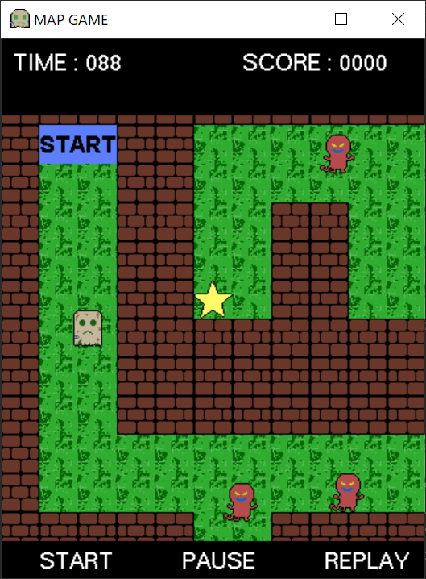
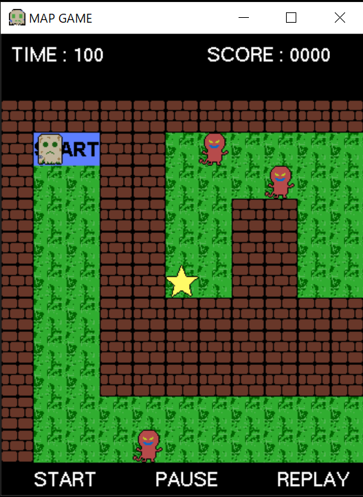
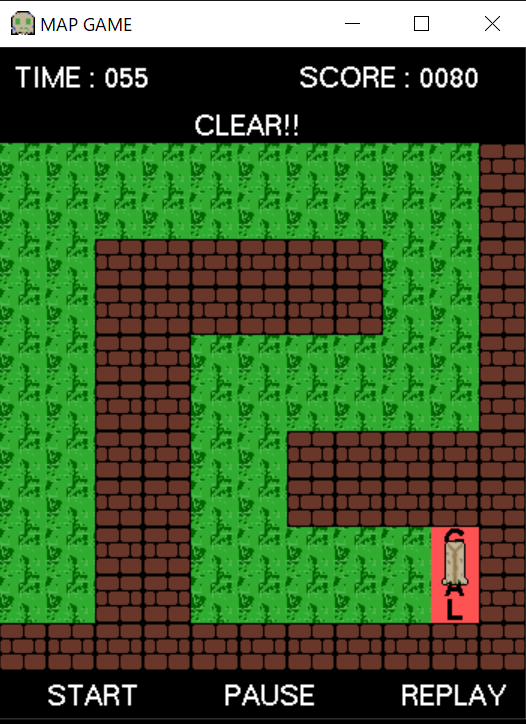
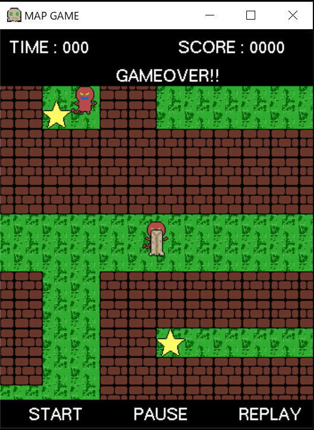

# OpenGL Maze Game

C言語とOpenGL/GLUTで制作した迷路型アクションゲームです。61×61マスの迷路をスクロールしながら探索し、制限時間内にゴールを目指します。



## 動作例

| 開始時 | クリア | ゲームオーバー |
|---|---|---|
|  |  |  |

通常のプレイ画面と迷路全体図を含む代表的な確認画像5枚を[`images/`](images/)に収録しています。

## 主な実装

- 迷路マップとスクロール表示
- カーソルキーによるキャラクター操作
- 壁との衝突判定
- 25体の敵の配置と自動移動
- 敵との接触による制限時間の増減
- アイテム取得とキャラクター強化
- 残り時間、クリア時間、スコアの管理
- START、PAUSE、REPLAYの状態管理
- キーボード・マウス入力
- PNG画像を利用したキャラクターとマップの描画

## 使用技術

- C
- OpenGL / GLU / GLUT
- glpng
- Cygwin GCC

## ソース構成

```text
.
├── README.md
├── assets/
│   ├── chara0.png ... chara7.png
│   ├── enemy0.png, enemy1.png
│   ├── goal0.png, goal1.png
│   ├── map0.png, map1.png
│   ├── start0.png, start1.png
│   └── item.png
├── images/
│   ├── gameplay.png
│   ├── start.png
│   ├── clear.png
│   ├── game-over.png
│   └── map.png
└── src/
    ├── base.h
    ├── central.c
    ├── layout.c
    ├── move.c
    └── print.c
```

## 操作

- カーソルキー：キャラクターの移動
- Enter：スタート／一時停止
- Backspace：ゲームのリセット
- `q`またはEsc：終了

現在の環境でのビルド・動作は再確認していません。
